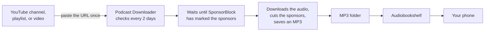
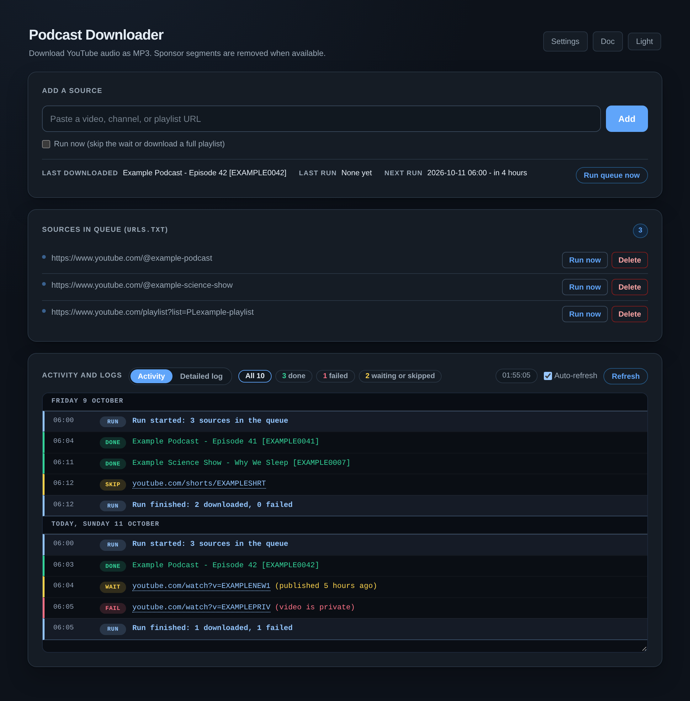

# Podcast Downloader

Turn YouTube channels, playlists, and videos into **sponsor-free MP3 podcasts**
for [Audiobookshelf](https://www.audiobookshelf.org/). Add a channel once; new
episodes show up in your podcast app on their own.





## Install

You need a computer that stays on, with [Docker](https://docs.docker.com/engine/install/).
Nothing else: no clone, no build, no config file to write. The image works on
ordinary PCs and servers (amd64) and on Raspberry Pi or ARM servers (arm64).

### Option A: Docker Compose (recommended)

Save this as `docker-compose.yml` in an empty folder:

```yaml
services:
  podcast-downloader:
    image: ghcr.io/gerardwu100/podcast-downloader:latest
    container_name: podcast-downloader
    restart: unless-stopped
    ports:
      - "6847:8000"           # web page at http://<server>:6847
    environment:
      - TZ=America/Toronto    # your time zone; runs start at 06:00 on this clock
    volumes:
      - ~/.containers/podcast-downloader:/data   # settings, queue, cookies, logs
      - ~/downloads/podcasts:/downloads          # the MP3 library
      - ~/downloads/temporary:/temporary         # files still being processed
```

Then start it from that folder:

```bash
docker compose up -d
```

A [fully commented version](docker-compose.example.yml) of this file is in the
repository too. It also joins a Docker network named `single`, where a reverse
proxy or Apprise can reach it.

### Option B: one `docker run` command

```bash
docker run -d --name podcast-downloader --restart unless-stopped \
  -p 6847:8000 \
  -e TZ=America/Toronto \
  -v ~/.containers/podcast-downloader:/data \
  -v ~/downloads/podcasts:/downloads \
  -v ~/downloads/temporary:/temporary \
  ghcr.io/gerardwu100/podcast-downloader:latest
```

### Before you start: two things to check

| Check | Why | What to change |
|---|---|---|
| The left side of each `/data`, `/downloads`, `/temporary` line | Those are the folders on your computer | Any folder you like. Point Audiobookshelf at the `/downloads` one. |
| Run `id -u` and `id -g` | The MP3 files should belong to you | If either is not `1000`, add `HOST_UID` and `HOST_GID` with those numbers next to `TZ` |

Then open **`http://<server address>:6847`**. There is no login by default.

### Update

| Installed with | Update with |
|---|---|
| Compose | `docker compose pull && docker compose up -d` |
| `docker run` | `docker pull ghcr.io/gerardwu100/podcast-downloader:latest`, then `docker rm -f podcast-downloader`, then the same `docker run` command again |

Your settings, queue, and MP3s live in the folders, not in the container, so
updating never loses them. Nothing updates on its own.

**Pin a version** if you would rather update on your own schedule: replace
`latest` with `2` (every 2.x release), `2.0` (fixes only), or `2.0.0` (exactly
that release). Each [release](https://github.com/GerardWu100/podcast-downloader/releases)
lists what changed.

## Use it

1. **Add a source.** Paste a channel, playlist, or video URL and select **Add**.
   The list shows it by its channel, playlist, or video name a few seconds
   later.
2. **Wait, or run now.** Runs start at 06:00 every other day. **Run queue now**
   starts one immediately.
3. **Listen.** In Audiobookshelf, add a podcast library that points at the MP3
   folder. Each channel becomes its own podcast.

```text
~/downloads/podcasts/
├── example-podcast/             ← one folder per channel or playlist
│   ├── Example Podcast - Episode 41 [EXAMPLE0041].mp3
│   └── Example Podcast - Episode 42 [EXAMPLE0042].mp3
├── example-science-show/
│   └── Example Science Show - Why We Sleep [EXAMPLE0007].mp3
└── singles/                     ← videos you added one by one
```

The activity panel shows what each run did. **Activity** is the short story,
**Detailed log** is the full output. Select a count such as **1 failed** to see
only those lines.

To put it on your phone's home screen, open the page over HTTPS in Chrome or
Safari and choose **Install app** or **Add to Home Screen**.

## Settings

| Setting | Default | Where |
|---|---|---|
| Delete channel episodes after N days | 30 days; videos added one by one are kept | Settings page |
| YouTube cookies, for when YouTube blocks downloads | none | Settings page |
| Alerts to Telegram, email, or Discord when something breaks | off | Settings page |
| Run time and how often | 06:00, every 2 days | `config.toml` |
| How many recent videos to check per channel | 2 | `config.toml` |

`config.toml` is in your settings folder (`~/.containers/podcast-downloader/`).
Edit it, then restart the container. Numbers and `true`/`false` are written
bare and text goes in quotes. A typo stops the container with a message that
names the setting, so check `docker logs podcast-downloader` if it will not
start.

### Add a password

With no login, anyone who can open the page can use it. That is fine on a home
network. Before you open it to the internet, put it behind HTTPS (a reverse
proxy such as Caddy or Cloudflare Tunnel) and turn the login on:

1. Edit `.env` in your settings folder. The first start created it.
2. Set `UI_USERNAME` and `UI_PASSWORD`.
3. Restart the container.

## Browser extension

Add the video you are watching with one click, without copying the URL.

| Browser | Install |
|---|---|
| Firefox 140+ | Download `podcast-downloader-firefox-<version>.xpi` from the [latest release](https://github.com/GerardWu100/podcast-downloader/releases/latest), drag it onto Firefox, and select **Add** |
| Chrome, Edge, Brave | Open `chrome://extensions`, turn on **Developer mode**, select **Load unpacked**, and choose `extension/chrome/` in this repository. After a `git pull`, select **Reload** on the extension's card. Without a clone, unzip `podcast-downloader-chrome-<version>.zip` from the [latest release](https://github.com/GerardWu100/podcast-downloader/releases/latest) and choose that folder |

Click the toolbar icon, enter the page address, such as
`192.168.1.20:6847`, and select **Save and test**. Fill in a username and
password only if you turned the login on. After that:

- Click the icon or press `Alt+Shift+D` to add the current page.
- Right-click a YouTube or Rumble video, or a link to one, to add it.

A notification says whether the episode is downloading now or waits for the
next run.

## Use it from an AI agent

Hermes, OpenClaw, Claude Code, Codex, and other agents that use skills can run
it for you: "add this video to my podcasts", "what downloaded today?", "is the
downloader working?". Send your agent this message:

```text
Install the Podcast Downloader skill from
https://raw.githubusercontent.com/GerardWu100/podcast-downloader/master/.agents/skills/podcast-downloader/SKILL.md
and connect it to my server.
```

The agent installs the [skill](.agents/skills/podcast-downloader/SKILL.md),
asks for the page address, and asks for a username and password only if you
turned the login on. It works through the server's small JSON API: add a URL,
list the sources, read recent activity, start a run, and check health.

## Troubleshooting

| What you see | What to do |
|---|---|
| Downloads fail with `HTTP 403` or "Sign in to confirm you're not a bot" | YouTube is blocking the server. Export cookies from a browser where you are signed in to YouTube (`yt-dlp --cookies-from-browser chrome --cookies cookies.txt`) and upload the file on the Settings page. |
| The Settings page says cookies expire soon | Export and upload fresh cookies the same way. |
| A new video shows **Wait** | Normal. A new video waits a day so SponsorBlock can mark the sponsors. To skip the wait for one video, tick **Run now** when you add it. |
| The container keeps restarting | Run `docker logs podcast-downloader`. A bad `config.toml` line is named in the last lines. |
| The MP3 files belong to root or another user | Set `HOST_UID` and `HOST_GID` (see *Before you start*) and restart. |

## Learn more

The **[wiki](https://github.com/GerardWu100/podcast-downloader/wiki)** explains
how it works and how to change it: the download pipeline, every setting and
command-line flag, the login model, alerts, the extension's API, and how to run
and test the code from a checkout. It is built from the [`docs/`](docs/)
folder.

## License

[MIT](LICENSE)
