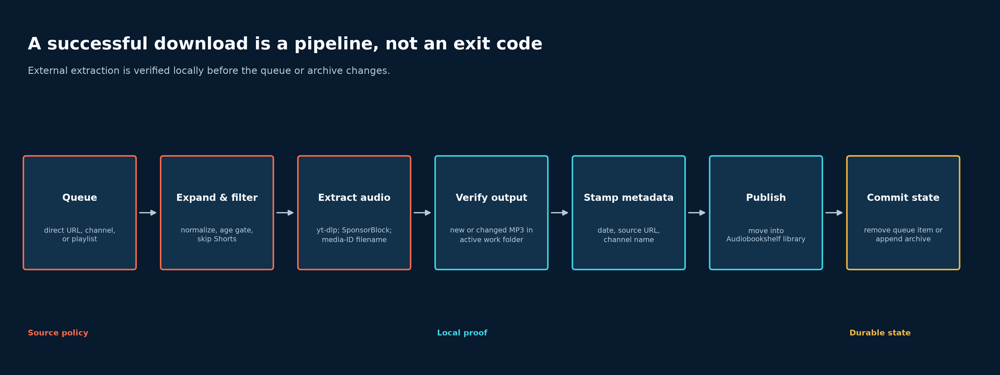
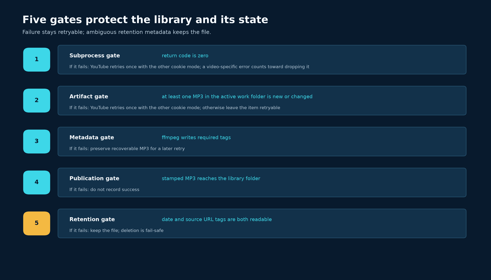

# Un téléchargeur de podcasts qui ne fait pas confiance au code de sortie 0

J'écoute plusieurs chaînes YouTube comme des podcasts. Je voulais retrouver les nouveaux épisodes sur mon téléphone, sans les passages sponsorisés et sans rien faire. Cela ressemble à une seule commande lancée par une minuterie. En pratique, l'essentiel du travail a porté sur la gestion des échecs autour de cette commande.

Le code se trouve sur [GerardWu100/podcast-downloader](https://github.com/GerardWu100/podcast-downloader).

## Ce que le service fait pour vous

Vous collez une seule fois l'URL d'une chaîne, d'une playlist ou d'une vidéo YouTube. Ensuite, le service :

- cherche les nouvelles vidéos tous les deux jours, à 6 h, heure locale ;
- attend 24 heures avant de télécharger une nouvelle vidéo, pour laisser aux utilisateurs de [SponsorBlock](https://sponsor.ajay.app/) le temps de marquer les passages sponsorisés, puis les coupe ;
- enregistre un MP3 avec pochette, chapitres et tags, dans un dossier par chaîne ou par playlist, qu'[Audiobookshelf](https://www.audiobookshelf.org/) affiche comme un podcast ;
- supprime les épisodes de chaîne après 30 jours, mais garde les vidéos ajoutées une par une ;
- vous prévient par [Apprise](https://github.com/caronc/apprise) (Telegram, courriel, Discord, etc.) quand un téléchargement échoue, quand une exécution planifiée n'a pas eu lieu ou quand les cookies YouTube vont bientôt expirer.

Les URL peuvent venir d'une page web qui s'installe comme une application sur le téléphone, d'une extension Firefox et Chrome avec un menu contextuel, d'une petite API JSON ou d'une skill pour agents IA. Le tout tourne dans un seul conteneur Docker pour amd64 et arm64, et `yt-dlp` se met à jour au démarrage du conteneur.

La plus grande partie du code sert à répondre à une seule question : quand un épisode existe-t-il vraiment ?

## D'une URL à un élément de la bibliothèque

`yt-dlp` fait l'extraction et retire les segments SponsorBlock `sponsor` et `selfpromo` grâce à son [option `--sponsorblock-remove`](https://github.com/yt-dlp/yt-dlp#sponsorblock-options). `ffmpeg` réécrit les tags. L'application décide quoi tenter, si la tentative a réussi et quand modifier l'état sauvegardé.

Les chaînes et les playlists sont développées en vidéos individuelles. Une exécution planifiée examine les deux entrées les plus récentes de chaque source, ignore les Shorts YouTube et retient les nouvelles vidéos jusqu'à ce qu'elles aient l'âge minimal. Les URL directes sont des tâches ponctuelles. Les URL hors YouTube, comme celles de Rumble, sont téléchargées comme éléments uniques, sans SponsorBlock.



Le schéma sépare trois décisions. La politique de source (corail) choisit *quoi* tenter. La preuve locale (cyan) établit si la tentative a produit un fichier exploitable et tagué. L'état durable (ambre) ne change qu'à la fin.

`yt-dlp` travaille dans un dossier temporaire propre à chaque source. Seul un MP3 tagué rejoint le dossier que lit Audiobookshelf. Le modèle de nom de fichier est `%(channel,uploader)s - %(title)s [%(id)s].%(ext)s`. L'identifiant du média entre crochets compte : deux épisodes d'une même chaîne peuvent porter le même titre, donc chaîne plus titre ne forme pas une clé unique.

## Définir la réussite à partir du système de fichiers

Un code de retour nul ne prouve pas qu'un nouveau MP3 existe. Un post-traitement peut abandonner après le transfert du média, ou un extracteur peut juger que l'élément est déjà présent ; dans les deux cas, le code de sortie reste à zéro. Le téléchargeur relève donc tous les MP3 du dossier temporaire de la source avant et après chaque tentative.

Pour un chemin MP3 $p$, soit $m(p)$ son heure de modification en nanosecondes et $z(p)$ sa taille en octets. L'état enregistré est

$$
s(p) = \bigl(m(p), z(p)\bigr).
$$

Soit $B$ l'ensemble des chemins MP3 avant la première tentative et $A$ l'ensemble après la dernière. Soit $s_B(p)$ et $s_A(p)$ l'état de $p$ dans chaque instantané. L'ensemble des fichiers modifiés est

$$
C = \left\{p \in A : p \notin B \;\lor\; s_A(p) \ne s_B(p)\right\}.
$$

La taille et l'heure de modification, prises ensemble, repèrent un nouveau fichier comme un fichier réécrit. Les deux instantanés restent dans le dossier de la source active : le MP3 d'une autre source ne peut donc pas valider cette tentative.

```python
@staticmethod
def changed_audio_files(
    before_snapshot: AudioSnapshot,
    after_snapshot: AudioSnapshot,
) -> list[Path]:
    """Return MP3 paths created or changed between two snapshots."""
    return sorted(
        audio_file
        for audio_file, after_state in after_snapshot.files.items()
        if before_snapshot.files.get(audio_file) != after_state
    )
```

Il reste un cas de récupération : une exécution précédente a téléchargé l'audio, puis a échoué en écrivant les tags. La tentative suivante renvoie zéro, mais ne change rien. Pour une URL $u$, soit $I_u$ l'ensemble des chemins MP3 dont le nom contient l'identifiant de la vidéo YouTube $u$ (n'importe quel chemin, pour les autres sites). L'ensemble de récupération est

$$
R_u = \left\{p \in A \cap I_u : s_A = s_B \;\land\; |A| = 1\right\}.
$$

Il reste vide sauf si rien n'a changé et qu'un seul MP3 est présent ; face à plusieurs candidats, le service ne devine pas.

Soit $r_u$ le code de retour de la dernière tentative et $C_u$ l'ensemble des fichiers modifiés pour $u$. La vérification locale vaut

$$
V(u) = [r_u = 0] \land \bigl[\,|C_u| > 0 \lor |R_u| = 1\,\bigr].
$$

Soit $M(u)$ le fait que les tags ont été écrits et $P(u)$ le fait que le MP3 tagué a atteint le dossier de la bibliothèque. La réussite durable est

$$
S(u) = V(u) \land M(u) \land P(u).
$$

La file d'attente et l'archive ne changent que lorsque $S(u)$ est vrai.

## Nouvelles tentatives, et quels échecs comptent

Pour une URL YouTube avec un fichier de cookies, le service fait au plus deux tentatives. La seconde change de mode d'authentification : avec cookies si la première n'en avait pas, sans cookies si elle en avait. Un code de sortie nul sans MP3 modifié déclenche aussi la seconde tentative, toujours lancée en mode verbeux pour que le journal garde la trace complète de l'extracteur. Une première diffusion (premiere) ou un direct qui n'a pas encore commencé reste en file, sans nouvelle tentative, et ne compte pas comme un échec.

Il n'y a pas de backoff exponentiel : par défaut, les téléchargements sont espacés de 60 secondes, et une tentative est limitée à une heure.

Une seconde règle décide quels échecs comptent. Une vidéo supprimée ou privée échoue à chaque exécution et, sans limite, enverrait aussi une alerte à chaque fois. Un échec ne compte donc pour l'abandon d'une vidéo que si l'erreur met en cause cette vidéo. Les erreurs HTTP 403 ou 429, les vérifications « not a bot », l'absence de jeton de preuve d'origine (PO token) et les erreurs réseau touchent toutes les vidéos de la même façon ; elles ne comptent pas. Soit $n_u$ le nombre d'échecs comptés pour $u$ et $N$ la valeur de `max_download_attempts` (2 par défaut). Le service abandonne la vidéo quand $n_u \ge N$. Une URL directe quitte la file. Une vidéo de chaîne garde son compteur, et les exécutions suivantes la sautent. Sans cette distinction, une semaine de blocages YouTube viderait la file.

## Les métadonnées font partie de la transaction

Après le téléchargement, trois tags sont écrits dans le MP3 :

- l'heure locale de fin dans `date` ;
- l'URL source normalisée dans `comment` ;
- le nom de la chaîne dans `artist` et `album`, si la recherche aboutit.

`ffmpeg` ne peut pas modifier un fichier sur place. Il écrit une copie taguée avec [`-codec copy`](https://ffmpeg.org/ffmpeg.html#Streamcopy) sous un nom temporaire caché qui ne se termine pas par `.mp3`, puis `os.replace` renomme cette copie par-dessus l'original en une seule opération atomique. Un lecteur voit soit le fichier sans tags, soit le fichier tagué, jamais un fichier partiel. L'audio n'est pas réencodé, et les marqueurs de chapitre que `yt-dlp` a décalés pour suivre l'audio coupé survivent à la copie.

L'heure de fin sert aussi d'horloge de rétention. Le nettoyage a lieu à chaque exécution, et seulement dans les dossiers des chaînes YouTube encore présentes dans la file. Les playlists et les téléchargements ponctuels ne sont jamais supprimés. Un fichier n'est admissible que si ses tags `date` et `comment` sont tous deux lisibles ; s'il en manque un, le fichier reste. Après une suppression, l'URL reste dans `downloaded_urls.txt`. Une version antérieure la retirait, mais le développement d'une chaîne renvoie ses vidéos les plus récentes, aussi anciennes soient-elles : une chaîne peu active retéléchargeait donc le même épisode tous les 30 jours.



Les quatre premières barrières gardent l'entrée de la bibliothèque : si l'une échoue, rien n'est enregistré et l'élément reste à retenter. La cinquième garde la sortie : un tag douteux conserve le fichier. Un doute sur un téléchargement coûte du travail refait plus tard ; un doute sur une suppression conserve les données.

## L'idempotence exige un verrou autour de la partie lente

Les vidéos de chaîne ou de playlist réussies vont dans `downloaded_urls.txt`, et le sondage suivant les ignore. La séquence « vérifier l'archive, télécharger, ajouter » reste pourtant exposée à une course : deux workers peuvent vérifier tous les deux avant que l'un ait ajouté l'URL. Le service garde un verrou de réservation exclusif pendant la vérification, le téléchargement lent et l'ajout :

```python
if use_archive:
    # A separate claim lock serializes expanded downloads without
    # holding the archive file lock while yt-dlp runs. Archive readers
    # in the web UI therefore remain responsive.
    with self.archive_store.locked_download_claim():
        if normalized_url in self.archive_store.load():
            self.logger.info("Already downloaded: %s", normalized_url)
            return normalized_url, True

        result_url, success = self._download_video_unlocked(
            normalized_url,
            index,
            total,
            target_final_output_dir,
            target_work_dir,
            use_archive=True,
        )
        if success:
            self.archive_store.append(normalized_url)
        return result_url, success
```

Le verrou de réservation est un fichier séparé. L'archive elle-même n'est verrouillée que pour de courtes lectures et écritures, si bien que la page web n'attend pas derrière un téléchargement qui peut durer une heure. Les URL directes partagent le dossier temporaire `singles` et prennent donc leur propre verrou. Les deux verrous reposent sur [`fcntl.flock`](https://docs.python.org/3/library/fcntl.html#fcntl.flock), ce qui suppose un système de fichiers local de type Unix.

Le prix à payer : les téléchargements de chaînes et de playlists passent un par un. Cela suffit pour un planificateur personnel ; avec de nombreux workers, il faudrait une file en base de données avec un bail par tâche.

## Une exécution qui ne fait rien doit le signaler

Les alertes par téléchargement ratent la pire panne. Si YouTube refuse de lister une chaîne, aucune vidéo n'est tentée, rien n'échoue, et l'exécution se termine sur « 0 successful, 0 failed », exactement comme une semaine calme. Chaque exécution complète est donc aussi vérifiée dans son ensemble. Une alerte part quand toutes les listes de chaînes et de playlists reviennent vides, quand les cookies de connexion expirent dans moins de 14 jours, quand le processus s'arrête avant de télécharger quoi que ce soit, ou quand le conteneur constate qu'il a manqué une exécution planifiée. Une exécution ordinaire n'envoie rien ; une alerte qui arrive a donc un sens.

## Limites de sécurité

Chaque URL passe après `--` dans la commande `yt-dlp` : une URL qui commence par des tirets ne peut pas devenir une option. Seules les requêtes YouTube reçoivent le fichier de cookies, stocké avec le mode `600` (propriétaire uniquement). La connexion est désactivée par défaut. Une fois activée, les mots de passe sont hachés avec PBKDF2, les formulaires portent des jetons contre la falsification de requête intersite (Cross-Site Request Forgery, CSRF), et cinq mauvais mots de passe bannissent l'adresse pendant 15 minutes. Cela convient à un seul opérateur, pas à une plateforme multi-utilisateur.

## Ce que les tests établissent

La suite hors ligne compte 453 tests. Ils utilisent des dossiers temporaires et des sous-processus simulés : ils vérifient le comportement, pas le débit.

| Frontière vérifiée | Preuve apportée par la suite |
|---|---|
| Détection des fichiers | Les MP3 nouveaux ou réécrits comptent ; le dossier d'une autre source et un code de sortie nul sans MP3 ne comptent pas |
| Récupération | Un MP3 laissé par une autre vidéo YouTube n'est jamais publié à sa place |
| Concurrence | Deux workers sur une même URL développée n'appellent `yt-dlp` qu'une fois |
| Comptage des échecs | Les blocages YouTube ne comptent jamais ; une vidéo de chaîne abandonnée est sautée ensuite |
| Rétention | Des tags manquants conservent le fichier ; un épisode supprimé n'est pas retéléchargé |
| Alertes | Listes vides, expiration des cookies et exécutions manquées produisent une alerte ; une exécution ordinaire n'en produit aucune |

## Les limites de cette conception

De simples fichiers conviennent à cette échelle, car ils sont faciles à lire et à sauvegarder. Le risque principal se trouve hors du code. YouTube change ses règles, les cookies expirent, la couverture SponsorBlock varie d'une vidéo à l'autre, et les URL de flux de la plupart des clients du lecteur YouTube exigent désormais un PO token. Le service fixe le client `web_embedded`, embarque Deno pour les défis JavaScript de YouTube et met `yt-dlp` à jour à chaque démarrage et avant chaque exécution planifiée. Ces choix réduisent les pannes ; ils ne peuvent pas les supprimer.

La règle locale est la partie à laquelle je fais confiance. Une commande qui renvoie zéro ne prouve rien. On vérifie le fichier, on le tague, on le publie, et seulement ensuite on marque le travail comme terminé.

## Références

- [README de `yt-dlp` : modèles de sortie, chemins et options SponsorBlock](https://github.com/yt-dlp/yt-dlp)
- [Catégories de segments SponsorBlock](https://wiki.sponsor.ajay.app/w/Segment_Categories)
- [Documentation FFmpeg : streamcopy et options de métadonnées](https://ffmpeg.org/ffmpeg.html)
- [Documentation Python : `fcntl.flock`](https://docs.python.org/3/library/fcntl.html#fcntl.flock)
- [Documentation Audiobookshelf](https://www.audiobookshelf.org/docs/)
