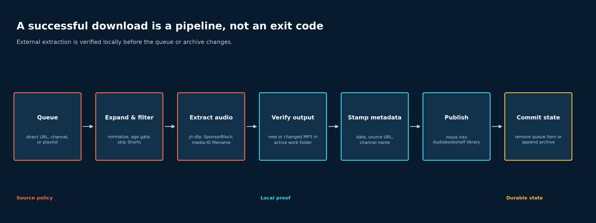
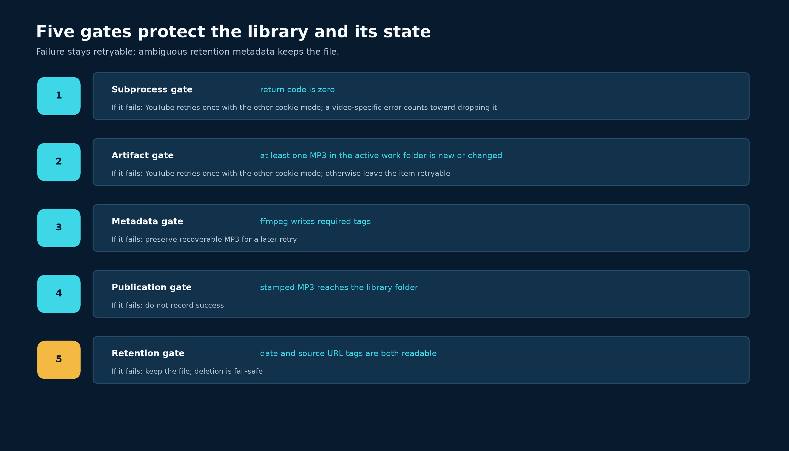

# A Podcast Downloader That Does Not Trust Exit Code 0

I listen to several YouTube channels as podcasts. I wanted new episodes on my phone without sponsor reads and without any effort from me. That sounds like one command on a timer. Most of the work went into the failure handling around that command.

The code is at [GerardWu100/podcast-downloader](https://github.com/GerardWu100/podcast-downloader).

## What it does for you

You paste a YouTube channel, playlist, or video URL once. After that, the service:

- checks for new uploads every two days at 06:00 local time;
- waits 24 hours before it downloads a new video, so [SponsorBlock](https://sponsor.ajay.app/) users can mark the sponsor reads, then cuts them out;
- saves an MP3 with cover art, chapters, and tags, in one folder per channel or playlist, which [Audiobookshelf](https://www.audiobookshelf.org/) shows as a podcast;
- deletes channel episodes after 30 days, but keeps videos you added one at a time;
- alerts you through [Apprise](https://github.com/caronc/apprise) (Telegram, email, Discord, and more) when a download fails, a scheduled run is missed, or the YouTube cookies are about to expire.

URLs can come from a web page that installs as a phone app, a Firefox and Chrome extension with a right-click menu, a small JSON API, or a skill for AI agents. It all runs in one Docker container for amd64 and arm64, and `yt-dlp` updates itself when the container starts.

Most of the code exists to answer one question: when does an episode really exist?

## From a URL to a library item

`yt-dlp` does the extraction and removes the SponsorBlock `sponsor` and `selfpromo` segments through its [`--sponsorblock-remove` option](https://github.com/yt-dlp/yt-dlp#sponsorblock-options). `ffmpeg` rewrites the tags. The application decides what to attempt, whether it worked, and when to change saved state.

Channels and playlists expand into individual videos. A scheduled run looks at the newest two entries of each source, skips YouTube Shorts, and holds new videos until they pass the age gate. Direct URLs are one-off jobs. Non-YouTube URLs, such as Rumble, are downloaded as single items without SponsorBlock.



The diagram separates three decisions. Source policy (coral) chooses *what* to attempt. Local proof (cyan) decides whether the attempt produced a usable, tagged file. Durable state (amber) changes only at the end.

`yt-dlp` works in a scratch folder for each source. Only a tagged MP3 moves into the folder that Audiobookshelf reads. The filename template is `%(channel,uploader)s - %(title)s [%(id)s].%(ext)s`. The media ID in brackets matters: two episodes from one channel can share a title, so channel plus title is not a unique key.

## Define success from the filesystem

A return code of zero does not prove that a new MP3 exists. A post-processor can give up after the media transfer, or an extractor can decide the item is already present, and the exit status stays zero in both cases. So the downloader records every MP3 in the source's scratch folder before and after each attempt.

For an MP3 path $p$, let $m(p)$ be its modification time in nanoseconds and $z(p)$ its size in bytes. The recorded state is

$$
s(p) = \bigl(m(p), z(p)\bigr).
$$

Let $B$ be the set of MP3 paths before the first attempt and $A$ the set after the last attempt. Let $s_B(p)$ and $s_A(p)$ be the state of $p$ in each snapshot. The changed-file set is

$$
C = \left\{p \in A : p \notin B \;\lor\; s_A(p) \ne s_B(p)\right\}.
$$

Size and modification time together catch a new file and an overwritten one. Both snapshots stay inside the active source folder, so another source's MP3 cannot count as success here.

```python
@staticmethod
def changed_audio_files(
    before_snapshot: AudioSnapshot,
    after_snapshot: AudioSnapshot,
) -> list[Path]:
    """Return MP3 paths created or changed between two snapshots."""
    return sorted(
        audio_file
        for audio_file, after_state in after_snapshot.files.items()
        if before_snapshot.files.get(audio_file) != after_state
    )
```

One recovery case remains: a previous run downloaded the audio, then failed while writing the tags. The next attempt returns zero but changes nothing. For a URL $u$, let $I_u$ be the MP3 paths whose file name contains the YouTube video ID of $u$ (any path, for other sites). The recovery set is

$$
R_u = \left\{p \in A \cap I_u : s_A = s_B \;\land\; |A| = 1\right\}.
$$

It stays empty unless nothing changed and exactly one MP3 is present; with several candidates, the service does not guess.

Let $r_u$ be the return code of the final attempt and $C_u$ the changed-file set for $u$. Local verification is

$$
V(u) = [r_u = 0] \land \bigl[\,|C_u| > 0 \lor |R_u| = 1\,\bigr].
$$

Let $M(u)$ mean that the tags were written and $P(u)$ mean that the tagged MP3 reached the library folder. Durable success is

$$
S(u) = V(u) \land M(u) \land P(u).
$$

The queue and the archive change only when $S(u)$ is true.

## Retries, and which failures count

For a YouTube URL with a cookie file, the service makes at most two attempts. The second attempt uses the other authentication mode: with cookies if the first had none, without them if it had them. A zero exit with no changed MP3 also triggers the retry, which always runs verbosely so the log keeps the full extractor trail. A premiere or livestream that has not started stays queued without a retry and does not count as a failure.

There is no exponential backoff: downloads are 60 seconds apart by default, and one attempt has a one-hour limit.

A second rule decides which failures count. A deleted or private video fails on every run and, without a limit, would send an alert on every run too. So a failure counts toward dropping a video only when the error blames that video. HTTP 403 or 429, "not a bot" checks, missing proof-of-origin (PO) tokens, and network errors fail every video in the same way, so they do not count. Let $n_u$ be the counted failures for $u$ and $N$ be `max_download_attempts` (default 2). The service drops the video when $n_u \ge N$. A direct URL leaves the queue. A channel video keeps its count, so later runs skip it. Without this split, one week of YouTube blocks would empty the queue.

## Metadata is part of the transaction

After the download, three tags go into the MP3:

- the local completion time in `date`;
- the normalized source URL in `comment`;
- the channel name in `artist` and `album`, when the lookup succeeds.

`ffmpeg` cannot edit a file in place. It writes a tagged copy with [`-codec copy`](https://ffmpeg.org/ffmpeg.html#Streamcopy) to a hidden temporary name that does not end in `.mp3`, and `os.replace` then renames that copy over the original in one atomic step. A reader sees either the untagged file or the tagged one, never a partial file. The audio is not re-encoded, and the chapter markers that `yt-dlp` shifted to match the cut audio survive the copy.

The completion time is also the retention clock. Cleanup happens on every run, and only in the folders of YouTube channels that are still in the queue. Playlists and one-off downloads are never deleted. A file is eligible only when both its `date` and `comment` tags can be read; if either is missing, the file stays. After a deletion, the URL stays in `downloaded_urls.txt`. An earlier version removed it, but channel expansion returns a quiet channel's newest videos however old they are, so the same episode downloaded again every 30 days.



The first four gates guard the way into the library: if one fails, nothing is recorded and the item stays retryable. The fifth guards the way out: an unclear tag keeps the file. Doubt about a download means repeating work later; doubt about a deletion means keeping data.

## Idempotency needs a lock around the slow part

Channel and playlist videos that succeed go into `downloaded_urls.txt`, so the next poll skips them. "Check the archive, download, append" is still racy: two workers can both check before either one appends. The service holds one exclusive claim lock across the check, the slow download, and the append:

```python
if use_archive:
    # A separate claim lock serializes expanded downloads without
    # holding the archive file lock while yt-dlp runs. Archive readers
    # in the web UI therefore remain responsive.
    with self.archive_store.locked_download_claim():
        if normalized_url in self.archive_store.load():
            self.logger.info("Already downloaded: %s", normalized_url)
            return normalized_url, True

        result_url, success = self._download_video_unlocked(
            normalized_url,
            index,
            total,
            target_final_output_dir,
            target_work_dir,
            use_archive=True,
        )
        if success:
            self.archive_store.append(normalized_url)
        return result_url, success
```

The claim lock is a separate file. The archive itself is locked only for short reads and writes, so the web page does not wait behind a download that can take an hour. Direct URLs share the `singles` scratch folder, so they take a second lock of their own. Both locks use [`fcntl.flock`](https://docs.python.org/3/library/fcntl.html#fcntl.flock), which assumes a local Unix-like filesystem.

The cost is that channel and playlist downloads run one at a time. That is fine for one personal scheduler; many workers would need a database queue with a lease per job.

## A run that does nothing must still say so

Per-download alerts miss the worst failure. If YouTube refuses to list a channel, no video is attempted, nothing fails, and the run ends with "0 successful, 0 failed", exactly like a quiet week. So each full run is also checked as a whole. One alert goes out when every channel and playlist listing came back empty, when the sign-in cookies expire within 14 days, when the process stops before it downloads anything, or when the container finds that it missed a scheduled run. An ordinary run sends nothing, so an alert that does arrive means something.

## Security limits

Every URL goes after `--` in the `yt-dlp` command, so a URL that starts with hyphens cannot become an option. Only YouTube requests get the cookie file, stored with owner-only mode `600`. Login is off by default. With it on, passwords are hashed with PBKDF2, forms carry Cross-Site Request Forgery (CSRF) tokens, and five wrong passwords ban the address for 15 minutes. That suits one operator, not a multi-user platform.

## What the tests establish

The offline suite has 453 tests. They use temporary folders and fake subprocesses, so they check behavior, not throughput.

| Verified boundary | Evidence in the suite |
|---|---|
| Artifact detection | New and overwritten MP3s count; another source's folder and a zero exit without an MP3 do not |
| Recovery | A leftover MP3 from a different YouTube video is never published as this one |
| Concurrency | Two workers on one expanded URL call `yt-dlp` once |
| Failure counting | YouTube blocks never count; a dropped channel video is skipped on later runs |
| Retention | Missing tags keep the file; a deleted episode is not downloaded again |
| Alerts | Empty listings, cookie expiry, and missed runs produce one alert; an ordinary run produces none |

## Where this design stops

Plain files suit this scale because they are easy to read and back up. The larger risk sits outside the code. YouTube changes its rules, cookies expire, SponsorBlock coverage varies by video, and the stream URLs from most YouTube player clients now need a PO token. The service pins the `web_embedded` client, ships Deno for YouTube's JavaScript challenges, and updates `yt-dlp` on every start and before each scheduled run. Those choices reduce breakage; they cannot remove it.

The local rule is the part I trust. A command that returned zero is not proof. Check the file, tag it, publish it, and only then mark the work complete.

## References

- [`yt-dlp` README: output templates, paths, and SponsorBlock options](https://github.com/yt-dlp/yt-dlp)
- [SponsorBlock segment categories](https://wiki.sponsor.ajay.app/w/Segment_Categories)
- [FFmpeg documentation: streamcopy and metadata options](https://ffmpeg.org/ffmpeg.html)
- [Python documentation: `fcntl.flock`](https://docs.python.org/3/library/fcntl.html#fcntl.flock)
- [Audiobookshelf documentation](https://www.audiobookshelf.org/docs/)
