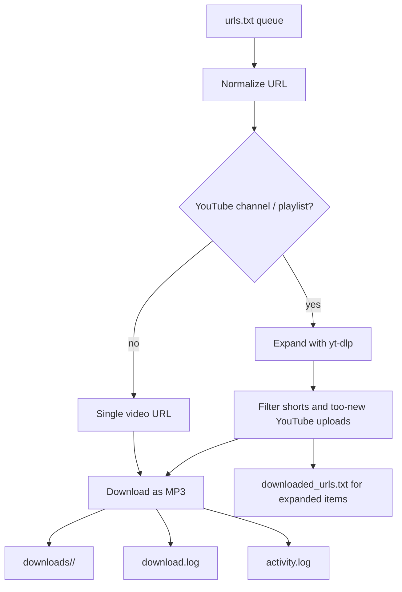

# Podcast Downloader

Podcast Downloader is a small self-hosted tool that turns online videos into MP3 files, removes SponsorBlock segments from YouTube downloads, and manages a queue from a web page or the command line.

This wiki is for people who want to know how it works, change it, or run it in an unusual way. To install and use it, the [README](https://github.com/GerardWu100/podcast-downloader#readme) is enough.

## What it does

- Accepts direct video URLs from `http` and `https` sites.
- Accepts YouTube `youtu.be` short links, channel URLs, channel livestream tabs, and playlist URLs.
- Finds the configured number of recent videos in each YouTube channel or playlist with `yt-dlp`.
- Uses the channel tab as the source mode: `/videos` means normal uploads, `/streams` means livestream entries, and a bare channel URL defaults to `/videos`.
- Filters out YouTube Shorts.
- Can wait before downloading new YouTube videos, giving SponsorBlock time to add segment data.
- Downloads audio as MP3 and stores it locally. The files also carry metadata,
  small descriptive tags such as the source URL and download date.
- Groups MP3 files by source under `downloads/`; direct videos go in `singles/`.
- Deletes old channel MP3 files according to the embedded download date, while leaving playlist and one-off files alone.
- Lets you add new URLs through a web page, with an optional login, and shows when the queue last ran and when it runs next.

## Main parts

- `src/cli.py`: command-line entrypoint.
- `src/downloads/`: download orchestration, `yt-dlp`, and audio metadata.
- `src/media/`: generic URL validation and YouTube-specific policy.
- `src/state/`: locked queue, archive, bypass, activity, authentication, and last-run state.
- `src/web/`: FastAPI construction, routes, authentication policy, and rendering.
- `src/api.py`: small Uvicorn deployment entrypoint.
- `src/schedule.py`: when automatic runs happen; 06:00 every other day by default.
- `src/run_report.py`: whether a finished run is worth a notification.
- `src/human_time.py`: the wording for times and durations shown to a person.
- `start.py`: Docker-oriented process supervisor for the API plus scheduler.

## Project shape

## Pages

| Page | Read it to |
|---|---|
| [Architecture](./architecture.md) | Follow a URL from the queue to an MP3, and see which module owns each step |
| [CLI and Config](./cli-and-config.md) | Look up a command-line flag or a `config.toml` setting |
| [Web UI and Security](./web-ui-security.md) | Understand the optional login, sessions, and browser protections |
| [Operations](./operations.md) | Run, update, and troubleshoot a deployment; cookies; the schedule |
| [Notifications](./notifications.md) | Set up Apprise alerts and read what each one means |
| [Browser Extension](./browser-extension.md) | Install, build, or sign the extension, and use the JSON API |
| [Development](./development.md) | Run from a checkout, test, and release |
